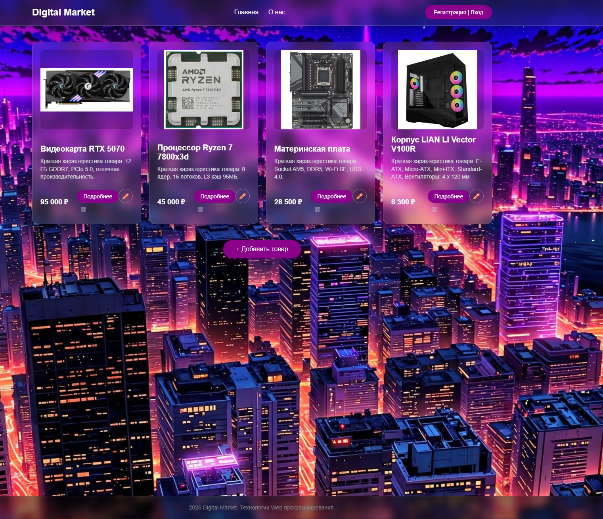
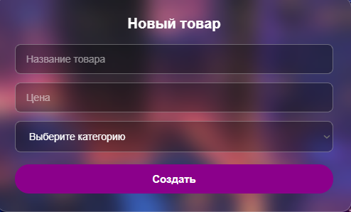
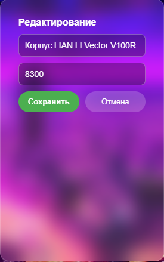
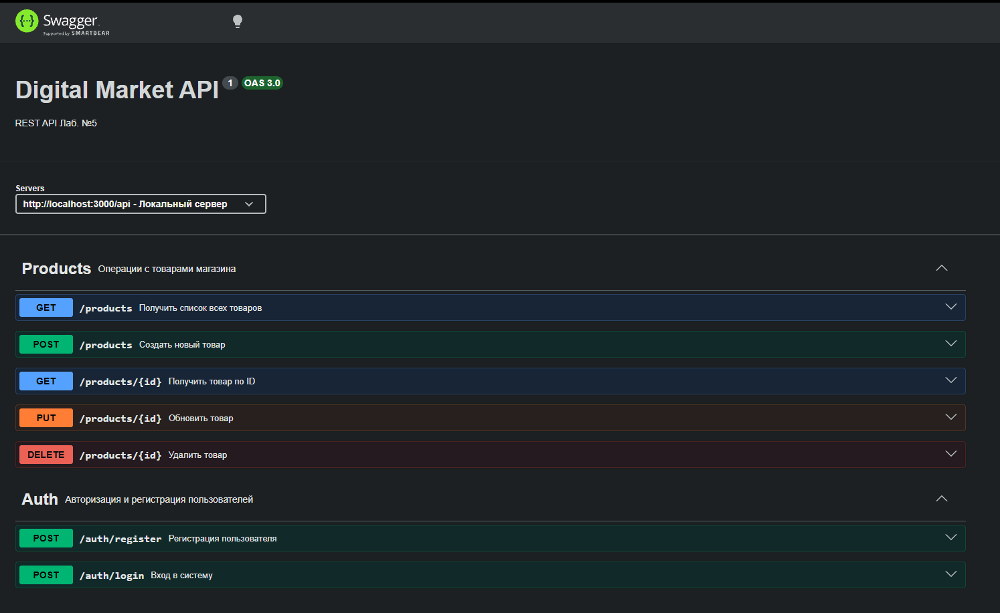
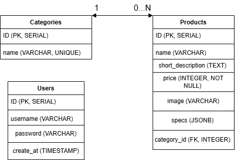

# Web Development Project

Репозиторий содержит учебный пет-проект по технологиям Web-программ.

## Технологии и стек

### Frontend
| Технология | Назначение |
|-----------|-----------|
| **Angular 17+** | Фреймворк SPA |
| **TypeScript** | Типизация |
| **RxJS** | Реактивное программирование |
| **Angular Router** | Клиентская маршрутизация |
| **HttpClient** | Взаимодействие с REST API |
| **SCSS** | Стилизация |

### Backend
| Технология | Назначение |
|-----------|-----------|
| **Node.js + Express** | Серверная часть приложения |
| **TypeScript** | Единый язык с фронтом |
| **PostgreSQL** | Реляционная СУБД с поддержкой JSONB |
| **pg (node-postgres)** | Драйвер для работы с БД |
| **bcryptjs** | Хэширование паролей |
| **jsonwebtoken** | JWT-токены для аутентификации |
| **Swagger UI** | Документация API |

### Инфраструктура
| Технология | Назначение |
|-----------|-----------|
| **Docker** | Контейнеризация БД |
| **Postman** | Тестирование API |

---

## Скриншоты интерфейса

### Главная страница

### Страница авторизации

### Создание нового товара

### Inline-редактирование товара

### Swagger-документация API

---

## Возможности

### Для пользователей
- Просмотр каталога товаров с адаптивной вёрсткой
- Детальная страница каждого товара с характеристиками
- Регистрация и вход в систему с JWT-аутентификацией
- Функция "Запомнить меня" (localStorage / sessionStorage)

### Для администратора
- **CRUD-операции** над товарами (создание, чтение, обновление, удаление)
- Динамические формы: характеристики автоматически подстраиваются под выбранную категорию
- Валидация данных на фронтенде и бэкенде
- Защита от SQL-инъекций через параметризованные запросы

### API
- Полноценный **REST API** с документацией в формате **Swagger**
- Интерактивное тестирование эндпоинтов прямо из браузера
- Поддержка всех HTTP-методов: `GET`, `POST`, `PUT`, `DELETE`

---

## Архитектура базы данных

